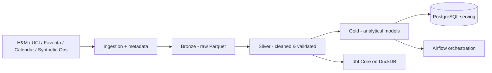

# E-commerce Inventory & Demand Intelligence Platform

A production-oriented Data Engineering platform that integrates large, messy, multi-source
retail data into a Medallion data lake (Bronze / Silver / Gold) supporting demand analysis
and inventory planning.

> Built as a portfolio project demonstrating Data Engineering capabilities: multi-source
> ingestion, data quality engineering, distributed vs. analytical processing, dimensional
> modeling, synthetic operational data, orchestration, testing, and CI/CD.

## Business problem

E-commerce retailers operate with fragmented historical sales, product catalogs, pricing
signals, and operational inventory data. Inconsistent identifiers, missing records,
duplicates, and delayed updates make demand and inventory planning unreliable.

This platform consolidates those sources into reliable, structured datasets that support
demand velocity, seasonality, inventory coverage, and replenishment analysis. Demand
forecasting and inventory analytics are downstream consumers of the platform; the primary
focus is Data Engineering.

## Architecture



Medallion layers:

- **Bronze**: original source preservation with ingestion metadata (Parquet).
- **Silver**: standardized schemas, normalized identifiers, validation, quarantine.
- **Gold**: dimensional/analytical models (demand, velocity, inventory, replenishment).

## Technology stack

| Capability | Technology |
|---|---|
| Language | Python 3.11 |
| SQL | SQL |
| Primary analytical engine | DuckDB |
| Distributed processing | Apache Spark / PySpark (benchmarked) |
| Storage | Apache Parquet |
| Architecture | Medallion |
| Transformations | dbt Core |
| Orchestration | Apache Airflow |
| Operational database | PostgreSQL |
| Data quality | pytest, dbt tests (Pandera planned) |
| Infrastructure | Docker Compose |
| Configuration | pydantic-settings |
| Logging | structlog |
| CI/CD | GitHub Actions |

## Data sources

| Source | Type | Purpose |
|---|---|---|
| H&M Personalized Fashion Recommendations | Real (Kaggle) | Historical fashion sales, catalog, customers |
| UCI Online Retail II | Real (UCI) | Heterogeneous retail transactions, returns |
| Corporación Favorita Store Sales | Real (Kaggle) | Large-scale retail demand & benchmark |
| Calendar / holidays | Real (python-holidays) | Seasonality |
| Synthetic ops (warehouses, inventory, POs, suppliers) | Synthetic (labelled) | Missing operational data |

Source-specific identifiers are never mixed. Every record carries `source_system`.

## Repository structure

```
ecommerce-demand-intelligence/
├── data/            # raw, bronze, silver, gold, samples (gitignored)
├── src/             # ingestion, transformation, storage, utils
├── scripts/         # runners, profiling, benchmarks
├── dbt/             # dbt Core models and tests
├── dags/            # Airflow DAGs
├── tests/           # pytest
├── infrastructure/  # Docker Compose
├── docs/            # architecture, ADRs, data dictionary, benchmarks
└── .github/         # CI/CD workflows
```

## Getting started

### Prerequisites
- WSL2 + Ubuntu, Docker Desktop, Git, pyenv.

### Environment
```bash
cd ~/projects/ecommerce-demand-intelligence
pyenv local 3.11.9
python -m venv .venv
source .venv/bin/activate
pip install -r requirements.txt -r requirements-dev.txt
```

### Ingestion & transformations
```bash
PYTHONPATH=. python scripts/run_ingestion.py
PYTHONPATH=. python src/transformation/silver.py
PYTHONPATH=. python src/transformation/gold.py
PYTHONPATH=. python src/transformation/synthetic_inventory.py
```

### dbt
```bash
cd dbt && ../.venv/bin/dbt build --profiles-dir .
```

### Infrastructure (PostgreSQL)
```bash
cp .env.example .env
docker compose -f infrastructure/docker-compose.yml --env-file .env up -d
```

### Tests & lint
```bash
.venv/bin/pytest -q
.venv/bin/ruff check src tests
```

### Benchmark (DuckDB vs PySpark)
```bash
PYTHONPATH=. .venv/bin/python scripts/benchmark_duckdb_vs_spark.py
```

## Results

- Bronze ingested: H&M sample (5k articles, 1.1k customers, 15.8k transactions) and
  UCI Online Retail II (~1.07M transactions).
- Silver standardized and validated; exact-duplicate transaction rows collapsed.
- Gold models: daily product demand, product velocity, UCI daily demand, synthetic
  inventory snapshots/POs/adjustments.
- dbt: 4 models, 6 data tests — all passing.
- Benchmark: DuckDB 0.36s vs PySpark 24.17s on ~1.07M rows (ratio 66x) in local mode.
- pytest: 2 passing; ruff: all checks passed.

## Data quality

- Missingness encoded as NaN/empty (not JSON null) — explicitly handled.
- `article_id` zero-padded to 10 digits (leading-zero preservation).
- Quarantine approach documented (not yet implemented as separate tables).
- Repeated purchases preserved; exact full-row duplicates collapsed.
- Referential integrity validated on H&M sample (0 violations).

## Limitations

- Full H&M and Favorita datasets require Kaggle credentials (not present); development
  uses the public H&M sample and UCI data. Ingestion code targets the official CSVs.
- Airflow and Spark are configured as code but not deployed in this local setup beyond
  the benchmark.
- Azure/Databricks/Delta are evaluated as future evolution, not implemented.
- Benchmark is a single local run on a small dataset.

## Documentation

- `docs/phase0-report.md` — Phase 0 research.
- `docs/setup.md` — environment setup.
- `docs/PROJECT_ENGINEERING_REPORT.md` — comprehensive engineering report.
- `docs/PROJECT_STATUS.md` — project status.
- `docs/TECHNICAL_INTERVIEW_GUIDE.md` — interview guide.
- `docs/PROJECT_COMPONENT_INVENTORY.md` — component inventory.
- `docs/decisions/` — ADRs.
- `docs/benchmarks/duckdb_vs_spark.md` — benchmark report.
- `docs/data-dictionary/` — data dictionary.

## License

Code: MIT. Data: subject to source terms (H&M Kaggle, UCI CC BY 4.0, Favorita Kaggle).
