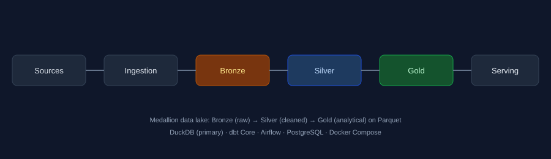

# E-commerce Inventory & Demand Intelligence Platform

<p align="center">
  
  
  
  
  
  
  
  
</p>

> A production-oriented Data Engineering platform that integrates messy, multi-source
> retail data into a Medallion data lake (Bronze / Silver / Gold) supporting demand
> analysis and inventory planning.

## Table of contents

- [Business problem](#business-problem)
- [Architecture](#architecture)
- [Technology stack](#technology-stack)
- [Data sources](#data-sources)
- [Repository structure](#repository-structure)
- [Getting started](#getting-started)
- [Results](#results)
- [Data quality](#data-quality)
- [Limitations](#limitations)
- [Documentation](#documentation)
- [License](#license)

## Business problem

E-commerce retailers operate with fragmented historical sales, product catalogs, pricing
signals, and operational inventory data. Inconsistent identifiers, missing records,
duplicates, and delayed updates make demand and inventory planning unreliable.

This platform consolidates those sources into reliable, structured datasets that support
demand velocity, seasonality, inventory coverage, and replenishment analysis.

## Architecture


flowchart LR
    Sources[Sources] --> Ingestion[Ingestion + metadata]
    Ingestion --> Bronze[Bronze - raw Parquet]
    Bronze --> Silver[Silver - cleaned & validated]
    Silver --> Gold[Gold - analytical models]
    Silver --> dbt[dbt Core on DuckDB]
    Gold --> Serving[(PostgreSQL serving)]
    Gold --> Airflow[Airflow orchestration]
```

Medallion layers:

- **Bronze**: original source preservation with ingestion metadata (Parquet).
- **Silver**: standardized schemas, normalized identifiers, validation, quarantine design.
- **Gold**: analytical models (demand, velocity, inventory, replenishment).

## Technology stack

| Capability | Technology |
|---|---|
| Language | Python 3.11 |
| Primary analytical engine | DuckDB |
| Distributed processing | Apache Spark / PySpark (benchmarked) |
| Storage | Apache Parquet |
| Architecture | Medallion |
| Transformations | dbt Core |
| Orchestration | Apache Airflow |
| Operational database | PostgreSQL |
| Data quality | pytest, dbt tests (Pandera planned) |
| Infrastructure | Docker Compose |
| Configuration | pydantic-settings |
| Logging | structlog |
| CI/CD | GitHub Actions |

## Data sources

| Source | Type | Purpose |
|---|---|---|
| H&M Personalized Fashion Recommendations | Real (Kaggle) | Historical fashion sales, catalog, customers |
| UCI Online Retail II | Real (UCI) | Heterogeneous retail transactions, returns |
| Corporación Favorita Store Sales | Real (Kaggle) | Large-scale retail demand & benchmark |
| Calendar / holidays | Real (python-holidays) | Seasonality |
| Synthetic ops | Synthetic (labelled) | Missing operational data |

Source-specific identifiers are never mixed. Every record carries `source_system`.

## Repository structure

```
ecommerce-demand-intelligence/
├── data/            # raw, bronze, silver, gold, samples (gitignored)
├── src/             # ingestion, transformation, utils
├── scripts/         # runners, profiling, benchmarks
├── dbt/             # dbt Core models and tests
├── dags/            # Airflow DAGs
├── tests/           # pytest
├── infrastructure/  # Docker Compose
├── docs/            # architecture, ADRs, benchmarks, reports
└── .github/         # CI/CD workflows
```

## Getting started

### Prerequisites
WSL2 + Ubuntu, Docker Desktop, Git, pyenv.

### Environment
```bash
cd ~/projects/ecommerce-demand-intelligence
pyenv local 3.11.9
python -m venv .venv
source .venv/bin/activate
pip install -r requirements.txt -r requirements-dev.txt
```

### Ingestion & transformations
```bash
PYTHONPATH=. python scripts/run_ingestion.py
PYTHONPATH=. python src/transformation/silver.py
PYTHONPATH=. python src/transformation/gold.py
PYTHONPATH=. python src/transformation/synthetic_inventory.py
```

### dbt
```bash
cd dbt && ../.venv/bin/dbt build --profiles-dir .
```

### Infrastructure (PostgreSQL)
```bash
cp .env.example .env
docker compose -f infrastructure/docker-compose.yml --env-file .env up -d
```

### Tests & lint
```bash
.venv/bin/pytest -q
.venv/bin/ruff check src tests
```

### Benchmark (DuckDB vs PySpark)
```bash
PYTHONPATH=. .venv/bin/python scripts/benchmark_duckdb_vs_spark.py
```

## Results

| Metric | Value |
|---|---|
| Bronze ingested | H&M sample (5k articles, 1.1k customers, 15.8k txns) + UCI (~1.07M txns) |
| dbt models / tests | 4 models, 6 tests — all passing |
| Benchmark | DuckDB 0.36s vs PySpark 24.17s (ratio 66x) |
| pytest | 2 passing |
| ruff | all checks passed |

## Data quality

- Missingness encoded as NaN/empty (not JSON null) — explicitly handled.
- `article_id` zero-padded to 10 digits (leading-zero preservation).
- Quarantine approach documented (not yet implemented as separate tables).
- Repeated purchases preserved; exact full-row duplicates collapsed.
- Referential integrity validated on H&M sample (0 violations).

## Limitations

- Full H&M and Favorita datasets require Kaggle credentials; development uses the
  public H&M sample and UCI data.
- Airflow and Spark are configured as code but not deployed beyond the benchmark.
- Azure/Databricks/Delta are evaluated as future evolution, not implemented.
- Benchmark is a single local run on a small dataset.

## Documentation

- [Phase 0 research](docs/phase0-report.md)
- [Setup guide](docs/setup.md)
- [Architecture overview](docs/architecture/overview.md)
- [Engineering report](docs/PROJECT_ENGINEERING_REPORT.md)
- [Project status](docs/PROJECT_STATUS.md)
- [Component inventory](docs/PROJECT_COMPONENT_INVENTORY.md)
- [Interview guide](docs/TECHNICAL_INTERVIEW_GUIDE.md)
- [ADRs](docs/decisions/)
- [Benchmark report](docs/benchmarks/duckdb_vs_spark.md)
- [Data dictionary](docs/data-dictionary/README.md)

## License

Code: MIT. Data: subject to source terms (H&M Kaggle, UCI CC BY 4.0, Favorita Kaggle).
