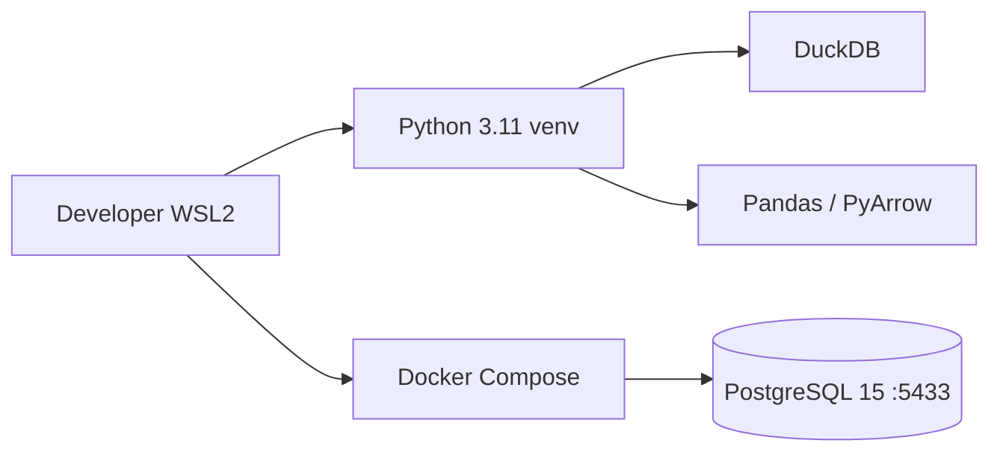

# E-commerce Inventory & Demand Intelligence Platform

Production-oriented data engineering platform integrating large, messy, multi-source retail data
(H&M transactions, calendar/holidays, and synthetic operational systems) into a Medallion
(Bronze/Silver/Gold) data lake supporting demand analysis and inventory planning.

> Status: **Phase 0 — Research and Architecture** (awaiting approval). See `docs/phase0-report.md`.

## Highlights (planned)

- Multi-source ingestion of ~31.8M real H&M transactions, plus UCI Online Retail II and Favorita.
- Medallion architecture on a local data lake (Parquet), DuckDB (primary) with PySpark benchmark.
- dbt Core transformations, Airflow orchestration, PostgreSQL serving layer.
- Data quality framework with quarantine and reason codes.
- pytest, Docker Compose, GitHub Actions.

## Repository layout

See `docs/phase0-report.md` §7.

## Local infrastructure (Phase 1)



The project pins Python **3.11.9** via pyenv (see `.python-version`). The system Python
(`/usr/bin/python3`, 3.14.x on Ubuntu 26.04) is intentionally left untouched.

### Provision Python 3.11.9

```bash
# build dependencies (Ubuntu)
sudo apt update && sudo apt install -y \
  build-essential libssl-dev zlib1g-dev libbz2-dev libreadline-dev \
  libsqlite3-dev curl git libncurses-dev xz-utils tk-dev \
  libxml2-dev libxmlsec1-dev libffi-dev liblzma-dev

# pyenv
curl https://pyenv.run | bash
# add to ~/.bashrc (once):
#   export PYENV_ROOT="$HOME/.pyenv"
#   [[ -d $PYENV_ROOT/bin ]] && export PATH="$PYENV_ROOT/bin:$PATH"
#   eval "$(pyenv init -)"
#   eval "$(pyenv virtualenv-init -)"

pyenv install 3.11.9

cd ~/projects/ecommerce-demand-intelligence
pyenv local 3.11.9   # creates .python-version
python --version      # Python 3.11.9
```

A virtual environment and project dependencies are provisioned in Phase 1 — Task 2.

### Data (not committed)

Raw and generated data are gitignored. Place the H&M files under `data/raw/hm/`:

```
data/raw/hm/
├── transactions_train.csv
├── customers.csv
└── articles.csv
```

A small public derived sample is available at `data/samples/hm_sample/` for schema verification
(not the official dataset).

### Profile the sample

```bash
python scripts/profile_hm_sample.py
```

## License

Code: MIT (to be confirmed). Data: H&M Kaggle competition terms (non-commercial, accept terms on Kaggle).
