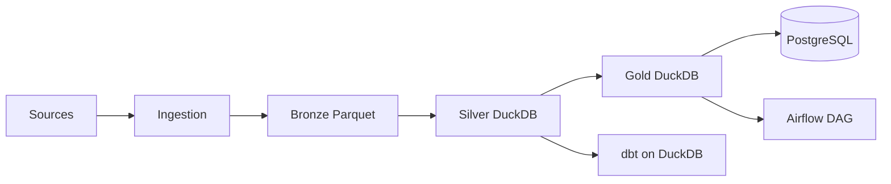
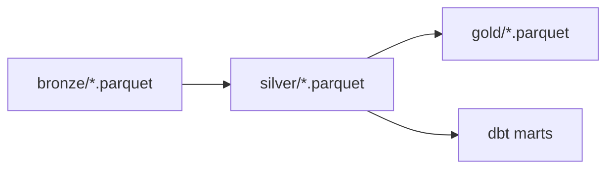

# Project Engineering Report

**Project:** E-commerce Inventory & Demand Intelligence Platform
**Repository:** https://github.com/Raf-Hs/ecommerce-demand-intelligence
**Audit date:** 2026-11-21
**Status:** Feature-complete for local scope; published.

---

## 1. Executive Summary

The project is a production-oriented Data Engineering platform that integrates messy,
multi-source retail data into a Medallion data lake (Bronze / Silver / Gold) supporting
demand analysis and inventory planning. It addresses data fragmentation, inconsistent
identifiers, missing records, and duplicate/conflicting data.

Implemented: ingestion (H&M sample + UCI), Silver standardization, Gold analytical models,
synthetic operational data, dbt Core (4 models, 6 tests), an Airflow DAG definition, a
DuckDB vs PySpark benchmark, pytest + ruff, Docker Compose PostgreSQL, GitHub Actions CI,
and comprehensive documentation. The repository is public on GitHub.

## 2. Business Problem and Objectives

E-commerce retailers face fragmented historical sales, product catalogs, pricing signals,
and operational inventory data. Inconsistent identifiers, missing records, duplicates, and
delayed updates make demand and inventory planning unreliable. The objective is to
consolidate these sources into reliable, structured datasets enabling demand velocity,
seasonality, inventory coverage, and replenishment analysis. Demand forecasting and
inventory analytics are downstream consumers; the primary focus is Data Engineering.

## 3. Data Sources

### H&M Personalized Fashion Recommendations (real, Kaggle)
- Format: CSV (`transactions_train.csv`, `customers.csv`, `articles.csv`).
- Volume (documented): ~31.8M transactions, ~1.37M customers, ~105.5k articles.
- Date range: 2018-09-20 to 2020-09-22.
- Fields: see `docs/phase0-report.md` §1.2–1.4.
- Quality challenges: NaN-encoded missingness, empty strings, leading-zero article IDs,
  repeated purchases, skewed postal codes.
- Access: Kaggle credentials required (blocker). Development uses public sample
  (`data/samples/hm_sample/`, 5k articles / 1.1k customers / 15.8k transactions).

### UCI Online Retail II (real, UCI, CC BY 4.0)
- Format: XLSX (`online_retail_II.xlsx`), 2 sheets.
- Volume (verified): 525,461 + 541,910 = 1,067,371 rows, 8 columns.
- Fields: Invoice, StockCode, Description, Quantity, InvoiceDate, Price, Customer ID,
  Country.
- Quality challenges: missing descriptions/customers, negative quantities (returns),
  cancellation invoices (prefix C), negative prices.
- Ingested via `src/ingestion/uci.py`.

### Corporación Favorita Store Sales (real, Kaggle)
- Status: approved source, not yet downloaded (Kaggle credentials blocker).
- Purpose: large-scale retail demand and DuckDB vs PySpark benchmark.

### Calendar / holidays (real, python-holidays)
- Derived date dimension with holiday flags.

### Synthetic operational data (synthetic, labelled)
- Warehouses, suppliers, inventory snapshots, purchase orders, stock adjustments.
- Generated deterministically (`SEED=42`) in `src/transformation/synthetic_inventory.py`.
- Every row carries `is_synthetic=True`, `source_system='synthetic_ops'`.

## 4. Architecture Overview

Technology responsibilities: Python (orchestration of scripts), DuckDB (Silver/Gold),
dbt (SQL models/tests), Airflow (DAG), PostgreSQL (serving), Docker Compose (infra),
GitHub Actions (CI).

## 5. Medallion Architecture Implementation

### Bronze
- Source ingestion via `src/ingestion/` (`base.py`, `hm_sample.py`, `uci.py`).
- Raw preservation as Parquet with metadata columns (`_source_system`, `_source_file`,
  `_ingestion_timestamp`).
- Object columns cast to string for Arrow compatibility.

### Silver
- `src/transformation/silver.py` (DuckDB).
- H&M: article_id zero-padded to 10 digits, customer missingness normalized, transactions
  validated (price >= 0), exact duplicates collapsed.
- UCI: column normalization, cancellation/return flags, datetime casting.

### Gold
- `src/transformation/gold.py` (DuckDB).
- H&M daily product demand, product velocity.
- UCI daily product demand.
- Synthetic inventory snapshots, suppliers, warehouses, POs, adjustments.

## 6. Data Modeling

- Source-specific identifiers preserved; never mixed across H&M and UCI (ADR-0003).
- Primary keys: article_id (10-digit), customer_id (hex), stock_code, invoice_no.
- Synthetic entities use `synthetic_ops` source_system.

## 7. Technology Stack

| Technology | Version | Purpose | Status |
|---|---|---|---|
| Python | 3.11.9 | Language | Implemented & executed |
| DuckDB | 2.0.1 | Primary analytical engine | Implemented & executed |
| PySpark | 3.5.3 | Distributed processing | Installed, benchmarked only |
| Parquet | pyarrow 26.0.1 | Storage format | Implemented & executed |
| dbt Core | 1.11.1 | SQL transforms | Implemented & executed |
| dbt-duckdb | 1.11.x | DuckDB adapter | Implemented & executed |
| Airflow | — | Orchestration | DAG defined, not deployed |
| PostgreSQL | 15 | Serving DB | Configured & verified |
| Pandas | 3.1.1 | Data processing | Implemented & executed |
| PyArrow | 26.0.1 | Parquet I/O | Implemented & executed |
| pydantic-settings | 2.16.3 | Configuration | Implemented |
| structlog | 26.1.0 | Logging | Implemented |
| pytest | 9.2.0 | Testing | Implemented & executed (2/2 pass) |
| Ruff | 0.17.6 | Linting | Implemented & executed (pass) |
| Docker Compose | v5.7.0 | Infrastructure | Configured & verified |
| GitHub Actions | — | CI/CD | Configured (not yet run) |
| python-holidays | 0.109 | Calendar | Dependency only |
| OpenJDK | 17.0.13 | Spark runtime | Installed (user-local) |

## 8. Data Processing and Transformation Logic

- Ingestion flow: `scripts/run_ingestion.py` → `src/ingestion/`.
- Transformation: `src/transformation/silver.py`, `gold.py`.
- Synthetic: `src/transformation/synthetic_inventory.py`.
- Config: `src/utils/config.py` (pydantic-settings, `.env`).
- Logging: `src/utils/logging.py` (structlog JSON).
- Reproducibility: `.python-version`, requirements files, Docker Compose, `.env.example`.

## 9. dbt Implementation

- Project: `dbt/dbt_project.yml` (profile `ecommerce_demand`).
- Models: 3 staging views + 1 mart table = 4 models.
- Tests: 6 data tests (not_null, unique).
- Execution: `dbt build` → 10/10 pass in 11.89s.
- Limitations: only H&M staging/mart; UCI and synthetic not yet modeled.

## 10. DuckDB vs PySpark Benchmark

- Objective: compare engines on a local aggregation workload.
- Dataset: UCI silver, ~1.07M rows.
- Methodology: group-by with sum, single run, local mode.
- Results: DuckDB 0.3643s, PySpark 24.1690s, ratio 66.34x.
- Conclusion: DuckDB dramatically faster for this single-node, sub-GB workload; Spark
  overhead dominates. Supports ADR-0002.
- Limitations: single run, no warm-up, small dataset, local mode only, no memory profiling.

## 11. Orchestration

- DAG: `dags/ecommerce_demand_pipeline.py`.
- Tasks: ingest_sources → build_silver → [build_gold, generate_synthetic_ops].
- Schedule: `@daily`, retries=1, catchup=False.
- Status: defined in code, not deployed or executed in Airflow.

## 12. Infrastructure and Environment

- OS: Ubuntu 26.04 (WSL2), Python 3.11.9 via pyenv.
- Dependencies: `.venv`, `requirements.txt`, `requirements-dev.txt`.
- Docker Compose: PostgreSQL 15 on host port 5433 (5432 occupied by other instance).
- Env vars: `.env` (gitignored), `.env.example` template.
- Setup: `docs/setup.md`, `infrastructure/README.md`.

## 13. Testing and Code Quality

- pytest: 2 tests (`tests/test_environment.py`), both pass.
- dbt: 6 tests, all pass.
- ruff: all checks pass.
- GitHub Actions: lint + tests on push/PR.
- Gaps: no integration tests for full pipeline; no data-quality tests beyond dbt.

## 14. CI/CD and Git Workflow

- Repository: https://github.com/Raf-Hs/ecommerce-demand-intelligence (public).
- 13 commits with conventional messages.
- CI workflow: `.github/workflows/ci.yml`.
- No deployment automation (only lint + tests).

## 15. Documentation and Engineering Decisions

ADRs:
- 0001: Phase 0 source selection and architecture.
- 0002: DuckDB primary, PySpark via benchmark.
- 0003: Data sources and source_system isolation.
- 0004: Python 3.11 via pyenv.
- 0005: Local-only Docker Compose.
- 0006: dbt Core transformations.

Gaps: no ADR for benchmark methodology or data quality framework details.

## 16. Limitations and Known Technical Debt

- Full H&M/Favorita not ingested (Kaggle credentials unavailable).
- Airflow not deployed.
- Spark only benchmarked locally on small data.
- Azure/Databricks/Delta not implemented.
- Single-run benchmark, no memory profiling.
- Limited test coverage (only smoke tests).
- No observability/monitoring beyond logging.

## 17. Security, Reliability, and Reproducibility

- Secrets: `.env` gitignored; `.env.example` template. No secrets committed.
- Config: pydantic-settings.
- Data integrity: metadata columns, validation in Silver, dbt tests.
- Idempotency: pipelines regenerate from Bronze; not tested for concurrent runs.
- Error handling: logging, retries in Airflow DAG.
- Reproducibility: `.python-version`, requirements, Docker Compose, `.env.example`.

## 18. Future Evolution

1. Ingest full H&M and Favorita datasets (Kaggle credentials).
2. Deploy and execute Airflow DAG.
3. Expand benchmarks across dataset sizes and measure memory.
4. Evaluate Delta Lake for incremental/transactional needs.
5. Consider Azure ADLS Gen2 + Databricks as cloud evolution.
6. Improve observability and monitoring.
7. Expand data quality and test coverage.

## 19. Final Engineering Assessment

Delivered: a coherent, documented, tested local data platform with ingestion, Medallion
layers, dbt models, synthetic ops, a benchmark, and CI. Demonstrates multi-source
ingestion, data quality handling, dimensional modeling, orchestration design, and
engineering discipline. Does not demonstrate: production deployment, large-scale
distributed processing, cloud integration, or comprehensive test coverage. Maturity:
portfolio-grade, not production-ready.

## 20. Technical Interview Preparation

See `docs/TECHNICAL_INTERVIEW_GUIDE.md` for questions and answer outlines with
source references.
