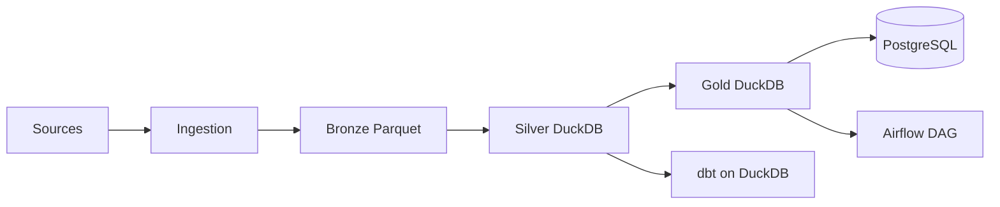
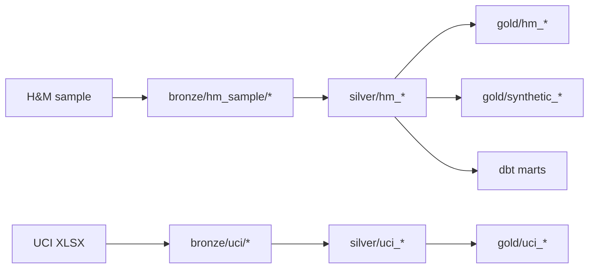

# Architecture Overview

## System architecture

## Medallion layers

- **Bronze**: raw preservation with ingestion metadata (`_source_system`, `_source_file`,
  `_ingestion_timestamp`).
- **Silver**: standardized schemas, normalized identifiers, validation, duplicate handling.
- **Gold**: analytical models (demand, velocity, inventory, replenishment).

## Data lineage

## Technology responsibilities

- Python: orchestration, ingestion, synthetic generation.
- DuckDB: Silver/Gold transforms and analytics.
- dbt Core: SQL models and tests on DuckDB.
- Airflow: DAG orchestration (defined, not deployed).
- PostgreSQL: serving layer.
- Docker Compose: local infrastructure.
- GitHub Actions: CI (lint + tests).
